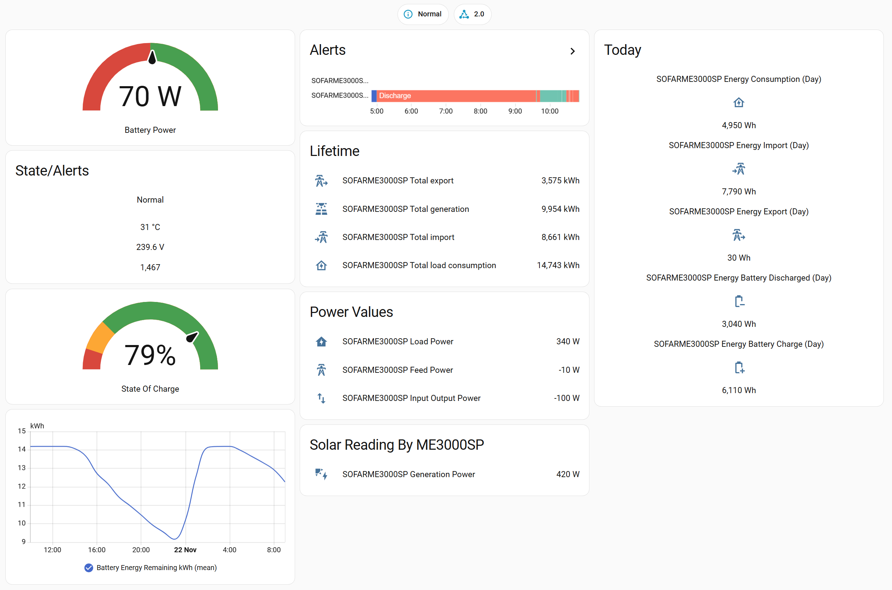

# ESPHOME_ME3000SP
Home Assistant (ESP Home) configuration for communication with SOFAR ME3000SP inverter over MODBUS/RS485

Configuration file uses ESP Home and an ESP8266 with RS485 chip for communication with SOFAR ME3000SP inverter (for battery storage).

The interface works in both directions:

* **Monitoring:** reads the inverter's live data (battery, grid, load, generation, daily and lifetime energy, temperatures, faults) into Home Assistant, ready for the energy dashboard.
* **Control:** force the battery to charge or discharge at a set power, hold it in standby, or return it to automatic self-consumption, from Home Assistant or its automations. See [Controlling charge and discharge](#controlling-charge-and-discharge).

Other devices supporting ESP Home and RS485 communication should work without significant change to the configuration.



## Hardware

This configuration was built and tested on deliberately old, cheap hardware:

* **ESP8266 NodeMCU** development board
* **MAX3485 RS485 transceiver**, powered from the NodeMCU's **3.3 V** pin

**The RS485 module must run at 3.3 V.** The ESP8266's pins are 3.3 V only. Many RS485 modules are built around the 5 V MAX485 chip, and powering one from 5 V puts 5 V on the ESP8266's RX pin, which can damage it. Use a 3.3 V transceiver such as the MAX3485 (or a module that states it works at 3.3 V), and power it from the 3.3 V pin, not 5 V or VIN.

Wiring, matching the `uart` and `modbus` sections of `sofarme3000sp.yaml`:

| MAX3485 | NodeMCU | Notes |
|---|---|---|
| VCC | 3V3 | **Not** 5 V / VIN |
| GND | GND | |
| DI (driver input) | TX (GPIO1) | |
| RO (receiver output) | RX (GPIO3) | |
| DE and RE (joined) | D1 (GPIO5) | Flow control: switches the transceiver between sending and receiving |
| A / B | Inverter RS485 terminal | If nothing is received, try swapping A and B |

The RS485 link uses the ESP8266's main hardware serial port (GPIO1/GPIO3), which is also connected to the board's USB serial chip. That's why logging is moved to UART1 (`hardware_uart: UART1`, `baud_rate: 0`) in the config. Disconnect the transceiver if you ever need to flash the board over USB; after that, updates go over WiFi.

Other ESPHome boards with a 3.3 V RS485 transceiver should work with only the pin numbers changed.

## Controlling charge and discharge

The configuration can tell the inverter when to charge and discharge, using SOFAR's "passive mode" commands (the same commands as the [Sofar2mqtt](https://github.com/cmcgerty/Sofar2mqtt) project).

This is optional. All the sensors work whatever mode the inverter is in; you only need Passive Mode if you want Home Assistant to control charging and discharging.

### Switch the inverter to Passive Mode

The inverter only accepts remote charge and discharge commands in Passive Mode. Until you switch it over, every command is rejected and Battery Command Result shows `Invalid work mode (is the inverter in Passive Mode?)`.

On the inverter's own display:

1. Open **Settings** and select **12. Work Mode Set**.
2. Select **4. Set Passive Mode** and press **OK**.

In Passive Mode the inverter only does what it's told, and stops managing the battery on its own. Set **Battery Mode** to **Auto** in Home Assistant to get its normal self-consumption behaviour (charge from surplus solar, discharge to cover the house load) while still allowing remote control.

To stop using remote control, go back to **12. Work Mode Set** and select **1. Set Auto Mode**. The inverter then manages the battery itself again, and ignores the controls in Home Assistant.

### Controls in Home Assistant

Home Assistant gets these entities:

| Entity | What it does |
|---|---|
| Battery Mode | **Auto** (normal self-consumption), **Charge**, **Discharge** or **Standby** (neither charge nor discharge) |
| Charge Power | Charge rate in watts (100–3000 W) used when Battery Mode is Charge |
| Discharge Power | Discharge rate in watts (100–3000 W) used when Battery Mode is Discharge |
| Battery Command Result | The inverter's reply to the last command, for example `OK, charge enabled` or `Invalid work mode (is the inverter in Passive Mode?)` |

Changing a power level while that mode is active re-sends the command straight away. The selected mode and power levels are remembered, and re-sent about 15 seconds after the ESP restarts.

To charge overnight on a cheap tariff, for example, use a Home Assistant automation that sets Battery Mode to Charge at the start of the cheap period and back to Auto at the end.

## Files

* `sofarme3000sp.yaml`: the device config (board, WiFi, API, UART and Modbus bus)
* `packages/sofar_me3000sp.yaml`: the sensors for one inverter, included once per inverter

In Home Assistant, copy both into the ESPHome config folder, keeping the `packages` subfolder:

```
/homeassistant/esphome/sofarme3000sp.yaml
/homeassistant/esphome/packages/sofar_me3000sp.yaml
```

That is the path seen from the File editor, Studio Code Server, SSH or Samba add-ons; ESPHome Device Builder sees the same folder as `/config/esphome/`. Device Builder only lists files directly in that folder, so the package in `packages/` won't appear as a device, and you edit it with one of those add-ons instead.

## Multiple inverters

Several inverters can share the same RS485 bus, as long as each one has a different RS485 address. To add a second inverter:

1. **Set a unique address on the new inverter.** On the inverter, go to Settings > 5. Set Communication Addr. and choose an address no other inverter uses, for example `2`. The current address is shown under System Information > RS485 Address.
2. **Wire it into the bus.** Connect the inverters as a daisy chain (ESP RS485 module → inverter 1 → inverter 2), with a 120 Ω terminating resistor at each end of the chain. Keep any branches off the main line short.
3. **Enable it in the config.** In `sofarme3000sp.yaml`, uncomment the `inverter2` block and set `modbus_address` to the address from step 1:

   ```yaml
     inverter2: !include
       file: packages/sofar_me3000sp.yaml
       vars:
         name_prefix: "Inverter 2 "
         id_prefix: inverter2
         modbus_address: 2
   ```

4. **For a third inverter or more**, copy the block as `inverter3`, with its own `id_prefix` (`inverter3`), `name_prefix` (`"Inverter 3 "`) and address.
5. **Validate and install** in ESPHome Device Builder. In Home Assistant, check that the new "Inverter 2 …" entities appear and that the first inverter's entities are unchanged.

The first inverter uses an empty `name_prefix`, so its entities keep their original names and history. Don't add a prefix to it later, or Home Assistant will create new entities and the old ones will lose their history.

## Secrets

The configuration reads its credentials from ESPHome's `secrets.yaml`. Add these entries before validating:

```yaml
wifi_ssid: "your-wifi-name"
wifi_password: "your-wifi-password"
ap_fallback_password: "fallback-hotspot-password"   # at least 8 characters
sofarme3000sp__encryption_key: "base64-api-key"
```

The API encryption key is also used to encrypt OTA updates, so no separate OTA password is needed. Generate a key with `openssl rand -base64 32`.

## Sensors Reported into Home Assistant

The configuration has the correct units, icons and device classes to make integration with energy dashboards easy.

* Running State
* Running State Description
* Fault Message 1
* Fault Message 2
* Fault Message 3
* Fault Message 4
* Fault Message 5
* Grid Voltage
* Grid Current
* Grid Frequency
* Battery Power
* Battery Voltage
* Battery Current
* State of Charge
* Battery Temperature
* Feed Power
* Load Power
* Input Output Power
* Generation Power
* EPS Voltage
* EPS Power
* Energy Generation (Day)
* Energy Export (Day)
* Energy Import (Day)
* Energy Consumption (Day)
* Total generation
* Total export
* Total import
* Total load consumption
* Energy Battery Charge (Day)
* Energy Battery Discharged (Day)
* Count Down Timer
* Inverter Alert Message
* Battery Cycles
* Inverter Temperature
* Inverter Heat Sink Temperature
* Inverter Alert Description
